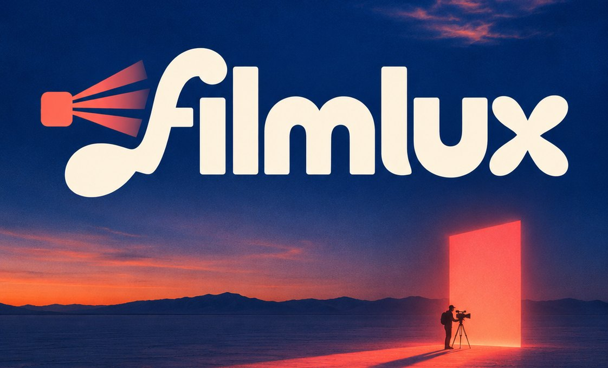
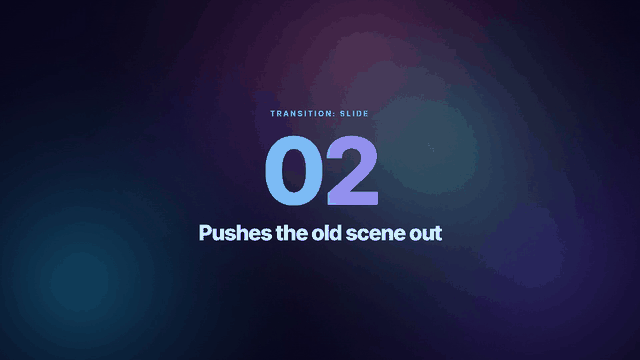
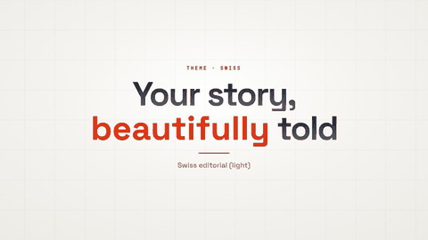
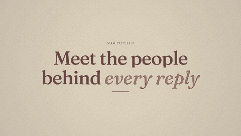
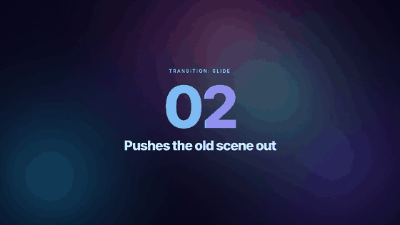
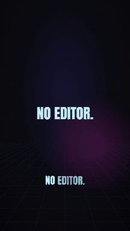
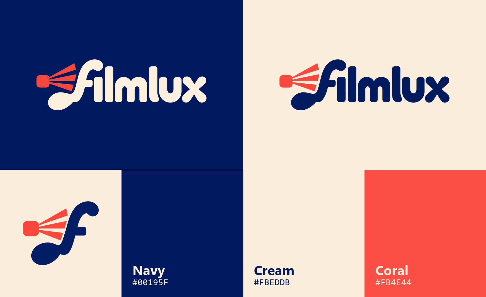

<p align="center">
  
</p>

<h3 align="center">Videos, made by your agent.</h3>

<p align="center">
  
  
  
  
</p>

<p align="center">
  
</p>

**Filmlux is a video engine your coding agent drives.** Point any coding agent (Codex, Claude Code, Gemini CLI, Cursor, GitHub Copilot or any other) at it, tell it what you need and drop in your files. The agent directs; Filmlux renders. You get a finished video with:
- a story
- natural voiceover
- original music
- captions
- branded motion design
- versions, subtitles and quality checks

You don't need a video editor or any design skills.

## See it in action

Everything below was made by Filmlux itself, from plain `project.json` files and without a video editor. The source projects are in `examples/`.

<table>
<tr>
<td width="50%" valign="top"><br><b>19 themes</b><br><sub>One script, any look: Swiss, neon, paper, brutalist, terminal, VHS and more</sub></td>
<td width="50%" valign="top"><br><b>12 style packs</b><br><sub>Promos, explainers, release films, data stories, cinematic, whiteboard and more</sub></td>
</tr>
<tr>
<td valign="top"><br><b>13 transitions, 13 motion styles</b><br><sub>Push, wipe, iris, cube and glitch, with real spring physics</sub></td>
<td align="center" valign="top"><br><b>9:16 social clips</b><br><sub>A two-second hook and word-by-word captions</sub></td>
</tr>
</table>

## Works with any agent

Filmlux is model-agnostic. Everything runs through plain `python studio.py …` commands and plain files, so any agent that can read files and run a terminal command can drive it: Codex, Claude Code, Gemini CLI, Cursor, GitHub Copilot or any other coding agent.

| Agent | Reads | Note |
|---|---|---|
| Codex | `AGENTS.md` | Allow network access (the voice needs it): Agent mode with full access, or `network_access = true` in the CLI sandbox settings |
| Claude Code | `CLAUDE.md` → `AGENTS.md` | Approve the `python studio.py` commands when asked, or allow them in your permission settings |
| Gemini CLI | `GEMINI.md` → `AGENTS.md` | Allow shell commands for this folder |
| Cursor, GitHub Copilot, others | `AGENTS.md` | Use agent mode so it can run commands |

If your agent doesn't pick up the instructions by itself, just say **"Read AGENTS.md and make my video."**

## Quick start: three ways in

1. **Ask the agent.** Open this folder in your coding agent and say **"Read AGENTS.md and make my video."** It interviews you, asks you to drop your files into `inbox/`, confirms a brief and a script with you, shows previews, renders, then iterates (v2, v3, …).
2. **Use Filmlux Studio (the app).** Run `python studio.py app`. For a double-click icon, run `python studio.py shortcut` once: it puts a **Filmlux** shortcut on your Desktop that works even on locked-down PCs, where `.bat` files and double-clicked `.py` files are often blocked. A local page opens where you can:
   - create projects
   - upload files to the inbox
   - preview stills and the soundtrack
   - run QA, render, and compare two versions side by side
   - generate AI-image requests
   - copy ready-made prompts for your agent
3. **Browse first.** Open `START_HERE.html` to see the styles, hear the voices and music, and build a brief (`inbox/brief.json`).

The app and the agent run the same commands, so you can switch between them at any point.

## What it can make

| Style pack | For | Built from |
|---|---|---|
| **Motion promo** | launches, teasers | kinetic type, bento grids, stats, end card |
| **Explainer** | how it works, training | processes, real-data charts, before/after, splits |
| **Release film** | product walkthroughs, "what's new" | your screen recordings, with a smooth camera, callouts and chapter cards |
| **Social vertical** | phone-first 9:16 clips | a two-second hook, big "pop" captions with the spoken word lit, one idea per screen |
| **Data story** | KPI updates, results, research | a headline finding, hero stat, charts with a message, a timeline |
| **Cinematic brand** | vision films, milestones | letterbox, grain, light leaks, serif type, slow dissolves, logo sting |
| **Kinetic type** | manifestos, announcements, openers | words as the visuals: slam, mask and snappy type on the beat |
| **Tech architecture** | systems, platforms, data flows | blueprint or terminal look, your diagrams, process flows, typed-on labels |
| **Whiteboard explainer** | training, how-tos, policies | hand-lettered titles, sketchy cards, write-on text |
| **Handmade story** | culture, team spotlights, community | cut-paper collage or risograph print, stop-motion movement |
| **Retro hype** | throwbacks, events, gaming | VHS tape or Y2K chrome, glitch and zoom cuts |
| **AI-illustrated** | concepts and stories without visuals | illustrations generated by your agent or any image app (optional), animated with Ken Burns and parallax |

- **Themes (19):**
  - Navy, Midnight, Paper
  - Swiss editorial, Newsroom data, Warm grain
  - Cinematic, Aurora glass, Neon tech
  - Neo-brutalist, Risograph print, Paper collage
  - Blueprint, Whiteboard, Terminal
  - Y2K chrome, Retro VHS, Bauhaus geometric, Soft clay

  Or make your own. Any pack works with any theme.
- **Motion (13 styles):** smooth, snappy, spring, bouncy, heavy (real spring physics, as in Remotion), mask, typewriter, stop-motion, focus pull, flip, slam, gentle, glitch.
- **Transitions (13):** fade, cut, slide, wipe (8 directions), flip, clock wipe, iris, cube, zoom, dip, flash, blur, glitch, with ease, linear or spring timing.
- **Formats:** 16:9, 9:16 (phone), 1:1, 4:5.
- **Scene types (17):** title, kinetic, bullets, stat, quote, chart (bar, column, line, donut), process, timeline, section, image (with parallax layers), split, bento, compare, logo sting, end, screen recordings, and custom HTML scenes (GSAP- and HyperFrames-compatible).
- **Captions:** glass, lower-third bar, or social "pop" (word by word). An `.srt` subtitle file comes with every render.
- **AI images (optional):** see `IMAGEGEN.md`. The studio writes exact prompts in the theme's style. Your agent generates them if it has an image tool; otherwise paste the prompts into any image app. Placeholders show until the images exist, and a check verifies them afterwards.

## Requirements

- **Windows 10/11 or macOS 12+** (Linux works too)
- **Microsoft Edge or Google Chrome**, used headless to draw frames
- **Python 3.10+**
- **Internet, only for the voice** (Microsoft neural voices via `edge-tts`), the first time each line is spoken; lines are cached after that

### Setup on Windows

```
pip install -r requirements.txt
python studio.py check
python studio.py shortcut        (optional: a "Filmlux" icon on your Desktop)
```

- On locked-down PCs, `.bat` files and double-clicked `.py` files are often blocked by policy. The shortcut points straight at `python.exe`, so it still works.

### Setup on macOS

Open **Terminal** in this folder (Finder: right-click the folder > New Terminal at Folder), then:

```
python3 -m pip install -r requirements.txt
python3 studio.py check
python3 studio.py shortcut       (optional: a "Filmlux" icon on your Desktop)
```

- On a Mac, type `python3` wherever these docs say `python`.
- No Python yet? Install it from python.org, or run `xcode-select --install`.
- The Desktop icon is a `.command` file. Double-clicking it opens a Terminal window that runs the app: keep that window open while you use the app, and close it to stop.

Nothing else to install: no FFmpeg, Node, After Effects or Premiere. Video encoding is built into PyAV.

## Folder map

```
START_HERE.html        visual guide + brief builder (open in a browser)
Open Filmlux.py     starts Filmlux Studio where double-clicking .py files is allowed (else: python studio.py shortcut)
AGENTS.md              instructions the coding agent follows (intake, workflow, rules)
PLAYBOOK.md            the craft: story, voice, music, looks, motion, screen recordings, quality loop
SPEC.md                project.json + theme reference: every scene type and option
IMAGEGEN.md            optional AI-generated images (any agent or image app)
CLAUDE.md, GEMINI.md   pointers to AGENTS.md for agents that read their own file name
studio.py              the command line
inbox/                 drop your files here
projects/              one folder per video (brief, script, project.json, assets, renders)
packs/                 12 style packs: recipes + starter projects
themes/                19 visual themes (colours, type, background, effects, motion, transitions, captions, image style)
examples/              finished example projects + synthetic demo footage
templates/             brief and storyboard templates
engine/                renderer (scene stage, footage composer, voice, music, encoder) + the Studio app
assets/                brand (Filmlux mark + BRAND.md), fonts (SIL OFL), logos, gallery stills, voice and music samples
docs/readme/           banner and GIFs for this README
tools/                 sample builder, demo app
```

## Commands

(On macOS, type `python3` instead of `python`.)

```
python studio.py app                                        the Studio app (local web page)
python studio.py shortcut                                   Desktop icon for the app (Windows .lnk / macOS .command; once per computer)
python studio.py check | voices | moods | packs | themes | motion
python studio.py new <name> --pack <pack> [--theme T] [--format 9:16]
python studio.py plan | stills | audio | qa | render | thumb <name>
python studio.py imagegen <name> [--check]                  optional AI images
```

Renders land in `projects/<name>/renders/<name>_vN.mp4`, next to an `.srt` subtitle file, a contact sheet and a QA report. Versions are never overwritten.

## Brand

<p align="center">
  
</p>

The Filmlux mark is a small projector throwing light (*lux*) into an **f**. Logo files for light and dark backgrounds, and the rules for using them, are in [`assets/brand/BRAND.md`](assets/brand/BRAND.md).

## Notes

- **Privacy:** your files stay on your machine. Narration **text** is sent to Microsoft's speech service, and AI image **prompts** to the image service, so keep personal and confidential data out of both. The Studio app listens only on this computer (127.0.0.1).
- **Licensing:**
  - The music is synthesised by the studio (royalty-free).
  - Fonts are SIL OFL: Inter, Inter Display, Fraunces, Instrument Serif, Space Grotesk, Anton and JetBrains Mono.
  - Voices are Microsoft neural TTS via `edge-tts`; check the terms before external or commercial use.
  - AI images: follow your organisation's policy, and say which images are AI-generated.
- **Speed:** previews take seconds. A final render takes about 6 minutes per minute of video, using two headless browsers in parallel.
